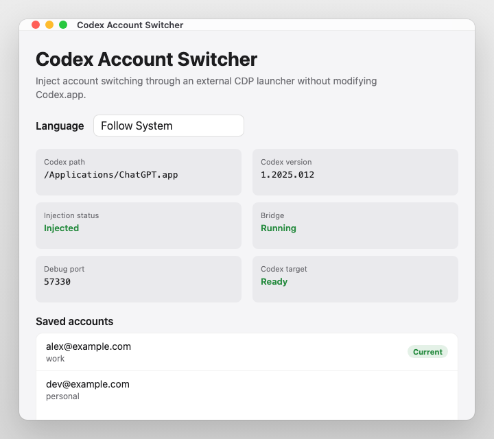
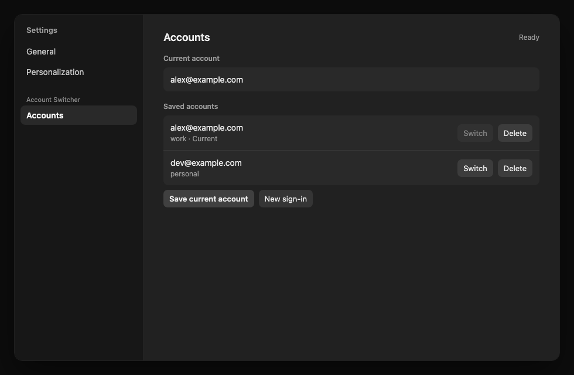
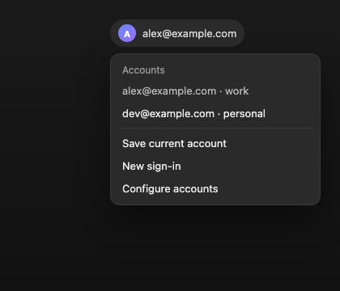

# Codex Account Switcher

Native macOS SwiftUI manager for launching Codex with an in-app account switcher.

## Screenshots

Screenshots use placeholder accounts (`@example.com`) for demo purposes.

### Launcher



### In-Codex settings



### Profile menu



This version does **not** modify `/Applications/Codex.app`. It starts Codex with a
local Chromium DevTools Protocol port, keeps a small local bridge process alive,
and injects the account UI into the Codex renderer at runtime.

The bridge stores logs and runtime state in:

```text
~/Library/Application Support/codex-account-switcher/
```

Saved Codex account snapshots use the Codex++ account-switcher-compatible
layout:

```text
~/.codex/auth.json
~/.codex/auth_accounts/<name>.json
~/.codex/current_account
~/.codex/auth_accounts_usage.json
```

## Build And Test

```sh
npm install
swift test
swift build
npm test
npm run check
.build/debug/CodexAccountSwitcher --status-json
```

Node tests are grouped by account runtime, asar assets, CDP targets and launch,
bridge behavior, renderer source guardrails, and public export compatibility.
Run one suite directly with `node --test test/<suite>.test.js`.

To produce a double-clickable app bundle:

```sh
scripts/package-app.sh
open dist/CodexAccountSwitcher.app
```

## Commands

```sh
.build/debug/CodexAccountSwitcher --status-json
.build/debug/CodexAccountSwitcher --launch
.build/debug/CodexAccountSwitcher --inject
.build/debug/CodexAccountSwitcher --stop
```

Compatibility aliases are still accepted:

```sh
.build/debug/CodexAccountSwitcher --install
.build/debug/CodexAccountSwitcher --repair --quiet
.build/debug/CodexAccountSwitcher --uninstall
```

Those aliases now map to launch, inject, and stop. They do not mutate Codex.app,
do not update asar integrity metadata, and do not re-sign the Codex bundle.
